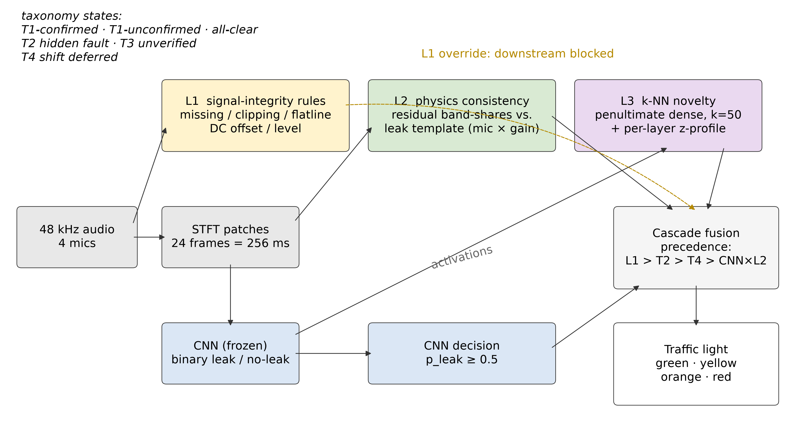
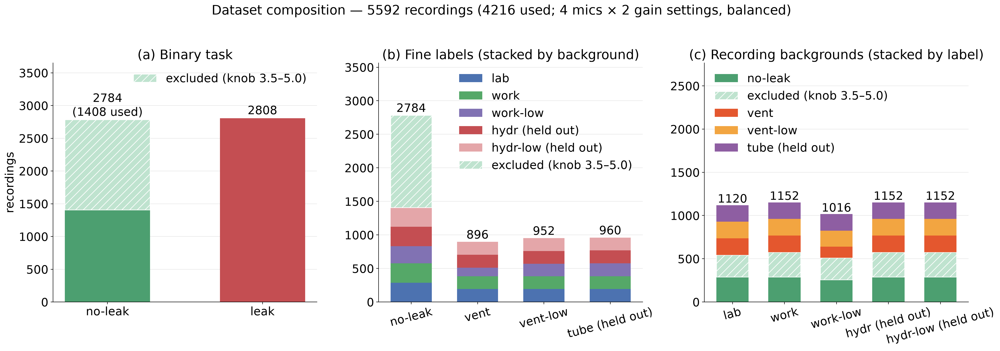
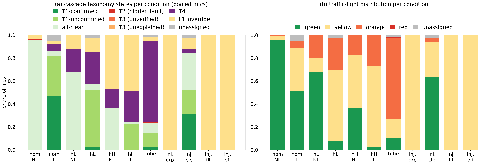
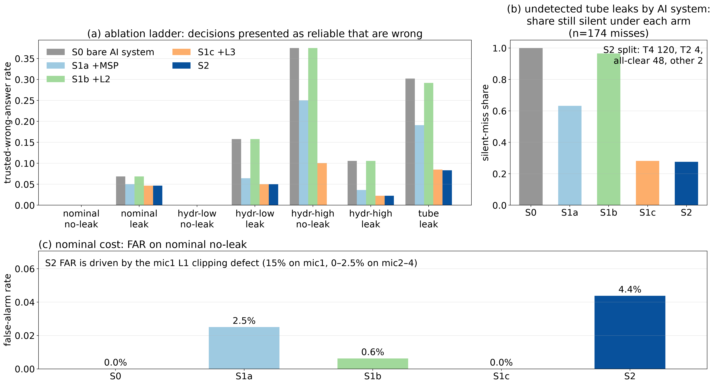
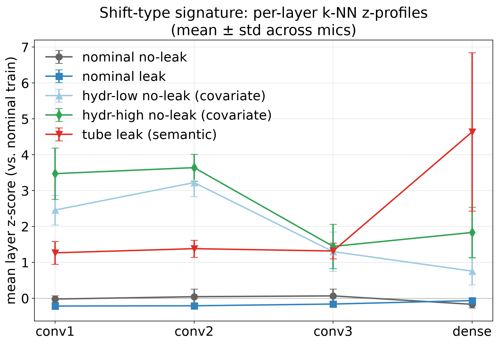
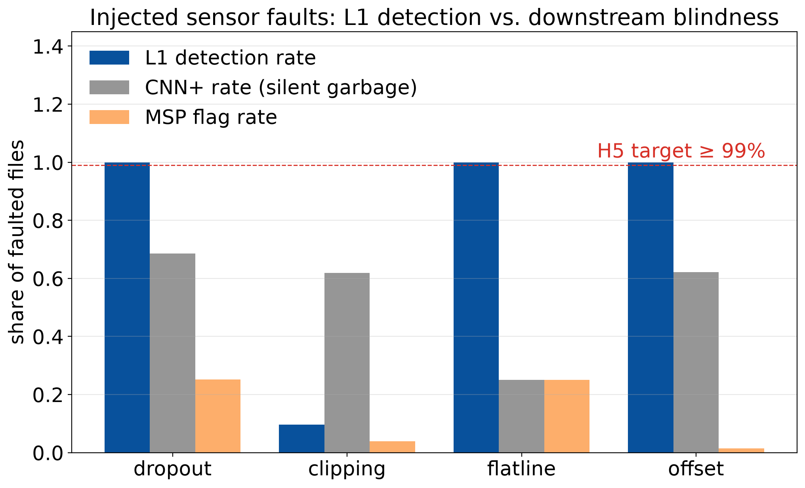

# COMET — Coordinated Multi-Layer Runtime Monitoring for AI Systems

COMET is a runtime monitoring framework that wraps a trained AI system with
several **local diagnoser monitors**, a **coordination layer**, and a
**communication layer**, so that a human supervisor can tell at any moment
whether the AI's output can be trusted. The structure is inspired by
coordinated diagnosis in fault-tolerant systems: each monitor acts as a local
diagnoser with its own view of the system, the coordination layer combines
their verdicts into an interpretable system state (a taxonomy), and the
communication layer condenses that state into a traffic-light display for the
human supervisor.

This repository contains the full experimental code for the accompanying
journal publication, in which COMET is instantiated with three monitors around
a CNN that detects compressed-air leaks from four microphone channels, and is
evaluated against held-out covariate shift (unseen hydraulic background
noise), semantic shift (a novel tube-leak fault class), and injected sensor
faults.



## The framework

**Local diagnosers (monitors).** Each monitor watches a different aspect of
the AI system and is calibrated on nominal development data only:

- **L1 — signal-integrity rules.** Cheap waveform checks (missing data,
  clipping, flatline, DC offset, level/gain anomaly). On a positive rule, L1
  *overrides*: downstream layers are blocked and the window is not classified.
- **L2 — physics consistency.** Compares the residual band-energy spectrum
  (observed minus estimated background) against per-microphone × gain leak
  templates, with a template-weighted abstention gate when there is
  insufficient excess signal. The physical assumptions behind the templates
  (severity scaling, cross-pressure shape invariance, leak/no-leak
  separability — checks v1–v3) were validated before deployment; the
  validation scripts and result plots are in `results/physics_assumptions/`.
- **L3 — deep feature-space novelty.** k-NN distance (k = 50) of L2-normalized
  penultimate (dense, 64-d) CNN activations to a frozen nominal reference
  store, LOO-calibrated at the 99th percentile of nominal no-leak scores. A
  layer-profile complement (per-layer z-scored k-NN distances vs. a nominal
  prototype) localizes *where* in the network a shift appears.

**Coordination layer (taxonomy).** The monitor verdicts and the CNN decision
are fused into one taxonomy state per file: `T1-confirmed`, `T1-unconfirmed`,
`all-clear`, `T2 (hidden fault)`, `T3 (unverified)`, `T3 (unexplained)`,
`T4 (shift deferred)`, or `L1_override` (precedence L1 > T2 > T4 > CNN×L2).

**Communication layer (traffic light).** Taxonomy states map to a four-level
display for the supervisor: **green** (output trustworthy), **yellow**
(context shifted, verdict deferred), **orange** (detection unverified),
**red** (hidden fault suspected).

## Case study and experimental design

The use case is binary leak detection (no-leak / leak) from 48 kHz audio of a
compressed-air test rig (IDMT-ISA-Compressed-Air dataset, Fraunhofer IDMT,
[Zenodo 7551606](https://doi.org/10.5281/zenodo.7551606)). One CNN per
microphone (4 mics × 2 gain settings); training and calibration use only the
*nominal envelope*: vent and vent-low leaks on lab / work / work-low
backgrounds. Everything the monitors are calibrated on is frozen
(`results/frozen_monitor_spec.json`) **before** the held-out conditions are
touched once (Phase B):

- **Covariate shift**: hydraulic background noise (`hydr`, `hydr-low`) —
  unseen environment, same fault class.
- **Semantic shift**: tube leaks — a fault class never seen in training.
- **Injected sensor faults**: dropout, clipping, flatline, DC offset applied
  to nominal audio at evaluation time.



## Headline results

Evaluation metric: the **trusted-wrong-answer (TWA) rate** — the share of
files where the system presents a wrong CNN decision as reliable, i.e. how
often a human supervisor is left misinformed.

- The bare AI system misinforms a supervisor on up to **37.5%** of files under
  covariate shift (hydr-high no-leak) and **30.2%** under semantic shift
  (tube leaks) — and 12–76% of those errors are *confident*
  (max-softmax ≥ 0.9), which no self-referential monitor can catch.
- The full COMET cascade reduces this to **0%** (hydr-high no-leak) and
  **8.3%** (tube). Every single-monitor arm has a blind spot; the cascade is
  best on every shifted condition.
- On injected sensor faults the CNN still reports "leak" on 25–69% of faulted
  audio (silent garbage); L1 blocks dropout/flatline/offset at ~100%
  (a known L1 clipping blind spot on mic1 remains).
- The supervision cost on nominal data is a **4.4%** pooled false-alarm rate
  (0–2.5% on mics 2–4; mic1 carries a known L1 clipping-rule defect at 15%).





The layer-profile complement also yields a shift-type *signature*: covariate
shift shows up in the early convolutional layers, while semantic shift peaks
in the dense layer.





Full numbers: `results/phase_b/phase_b_summary.json`,
`results/phase_b/ablation_ladder.json`,
`results/phase_b/tables/`.

## Repository layout

```
configs/          experiment configs (baseline, noise-augmented, SupCon ablation)
models/           LeakCNN architecture
preprocessing/    dataset index builder, STFT patch dataset
training/         session-fold cross-validation trainer
inference/        shift evaluation helpers
monitoring/       COMET monitors, calibration, freeze, phase-B evaluation,
                  ablation ladder, edge profiling, paper figures
results/          frozen monitor spec, calibration summaries, phase-B tables,
                  physics-assumption checks, paper figures
```

Large intermediate artifacts (per-file score arrays, cached spectrograms,
training runs) are excluded; every published number can be regenerated with
the steps below.

## Reproducing the results

Requires Python 3.11+ (CUDA optional; set `training.device: cpu` in the
configs to run CPU-only).

```bash
python -m venv .venv && source .venv/bin/activate
pip install -r requirements.txt

# 1. Download the IDMT-ISA-Compressed-Air dataset (Zenodo 7551606) into data/
# 2. Build the metadata index
python -m preprocessing.build_index --root data --out data/index.csv

# 3. Train the per-microphone CNNs (frozen models = noise-augmented runs)
python -m training.train --config configs/noise_aug_mic1.yaml   # repeat mic2-4

# 4. Build and calibrate the monitors (nominal data only)
python -m monitoring.build_physics_l2 --config configs/noise_aug_mic1.yaml
python -m monitoring.build_l3 --config configs/noise_aug_mic1.yaml
python -m monitoring.final_calibration_l3 --config configs/noise_aug_mic1.yaml
python -m monitoring.phase_a_plus --config configs/noise_aug_mic1.yaml

# 5. Freeze the monitor spec
python -m monitoring.freeze_spec --config configs/noise_aug_mic1.yaml

# 6. Single post-freeze evaluation on the held-out conditions (Phase B)
python -m monitoring.phase_b_score
python -m monitoring.phase_b_report
python -m monitoring.ablation_ladder

# 7. Regenerate the paper figures
python -m monitoring.paper_figures
python -m monitoring.paper_dataset_figure
```

## Citation

If you use this code, please cite the accompanying publication:

```bibtex
@misc{flehmig2026cometcoordinatedmultilayerruntime,
      title={COMET: A coordinated multi-layer runtime monitoring framework for human-supervised AI-enabled safety systems},
      author={Niclas Flehmig and Mary Ann Lundteigen and Shen Yin},
      year={2026},
      eprint={2610.29816},
      archivePrefix={arXiv},
      primaryClass={cs.AI},
      url={https://arxiv.org/abs/2610.29816},
}
```

and the dataset:

> IDMT-ISA-Compressed-Air, Fraunhofer IDMT, https://doi.org/10.5281/zenodo.7551606

## License

MIT — see [LICENSE](LICENSE). The dataset is third-party and must be obtained
from Zenodo under its own terms.
